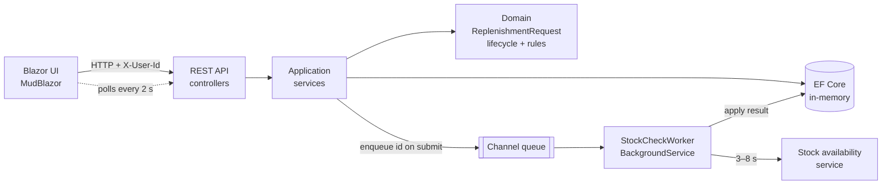
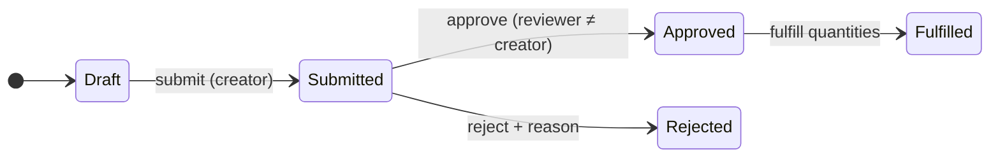

# Stock Replenishment Request System


Factory workers request material refills when stock runs low at their station,
a reviewer approves or rejects the request, and approved requests get fulfilled.
A slow external stock availability check runs in the background, so nobody waits for it.

**Highlights**
- **Rich domain model:** the request lifecycle (`Draft → Submitted → Approved/Rejected → Fulfilled`) is enforced inside the entity, so an illegal transition can't happen from anywhere.
- **Asynchronous request-reply:** submit returns `202 Accepted`; a queue and a background worker run the 3–8 s stock check; the UI polls for the result.
- **Segregation of duties:** reviewers can never approve, reject or fulfill their own request, and this is enforced server-side.
- **Secure by default:** input bounds, rate limiting, security headers, problem-details errors with no leaked internals.
- **Tested:** 33 NUnit tests (domain rules without mocks, services with in-memory EF Core + NSubstitute), plus a Postman collection.

📐 **Full architecture:** [docs/architecture.md](docs/architecture.md) covers the component view, state machine, sequence diagram, data model, API reference, design decisions and the path to production on Azure.

## Tech stack

| Layer | Technology |
|---|---|
| Runtime | .NET 10, ASP.NET Core |
| API | REST controllers, data-annotation validation, RFC 9457 problem details, built-in rate limiter |
| UI | Blazor (interactive server rendering) + MudBlazor |
| Data | Entity Framework Core 10 (in-memory provider) |
| Background processing | `BackgroundService` + `System.Threading.Channels` |
| Testing | NUnit 4, NSubstitute, Postman |

## Architecture at a glance





## Getting started

Prerequisite: the [.NET 10 SDK](https://dotnet.microsoft.com/download).

```bash
dotnet build
dotnet run --project StockReplenishment.App
```

Then open http://localhost:5000. The database is seeded on startup with four
users, three locations, and a request in every lifecycle state, so there is
something to look at right away. The ℹ️ icon in the top bar opens a short tour.

Run the tests with:

```bash
dotnet test
```

If you prefer testing the API directly, the `postman/` folder has a ready-made
Postman collection: run `1. Setup` first (it captures the user and location ids),
then `2. Request workflow`, `3. Locations` and `4. Error scenarios`.

## How to use it

There is no login. Instead,
the **Acting as** dropdown in the top bar switches between the seeded users,
and every API call carries the chosen user in an `X-User-Id` header. The rules
are enforced on the server:

- Only the person who created a request can submit it.
- Approving, rejecting and fulfilling need a reviewer, and never the person
  who created the request, even if they happen to be a reviewer.
- Only reviewers manage stock locations, and a location that still has
  requests attached cannot be deleted.
- A rejection always needs a reason.

The typical flow: act as a worker, create a request (location, priority, one
or more line items), submit it, and watch the stock check resolve on the
detail page. Then switch to a reviewer to approve and fulfill it.

## API overview

| Method | Route | Who |
|---|---|---|
| GET | `/api/users` | anyone |
| GET / POST / PUT / DELETE | `/api/locations[/{id}]` | read: anyone · write: reviewer |
| GET | `/api/requests?status=&priority=&locationId=&page=&pageSize=` | anyone |
| GET | `/api/requests/{id}` | anyone |
| POST | `/api/requests` | any user |
| POST | `/api/requests/{id}/submit` → **202** | creator |
| POST | `/api/requests/{id}/approve` · `/reject` · `/fulfill` | reviewer ≠ creator |

Errors come back as problem details: 400 (validation), 403 (role or ownership), 404, 409 (wrong state or conflict), 429 (rate limit).
Request and response bodies are in [docs/architecture.md#7-api-reference](docs/architecture.md#7-api-reference).

## The slow stock check

The requirement asks for a slow external stock availability check that must not
block the user. My approach:

1. Submitting a request returns **202 Accepted** immediately.
2. The request id goes onto an in-process queue (`Channel<Guid>`).
3. A background worker picks it up, calls the fake external service
   (3–8 seconds, random result), and saves the outcome.
4. The client polls `GET /api/requests/{id}` to learn the result. The detail
   page does this every 2 seconds while the check is pending, so the outcome
   just appears on screen.

The worker creates its own DI scope per message, ignores results for requests that are
no longer pending (idempotent), and logs a failed check without stopping. The
[sequence diagram](docs/architecture.md#5-asynchronous-stock-check) shows the full flow.

## How the code is organized

```
StockReplenishment.sln
├── StockReplenishment.App/
│   ├── Domain/            entities, enums, lifecycle rules (ReplenishmentRequest)
│   ├── Services/          application services, StockCheckQueue, StockCheckWorker
│   ├── BackendApi/        controllers, DTOs + validation, DomainExceptionHandler
│   ├── DataAccess/        AppDbContext (EF Core)
│   ├── Database/          SeedData
│   ├── Frontend/          Blazor pages, layout, UserState, UserHeaderHandler
│   ├── DependencyInjection.cs   one extension method per layer
│   └── Program.cs         HTTP pipeline
├── StockReplenishment.Tests/    NUnit + NSubstitute (33 tests)
├── postman/               end-to-end API collection
└── docs/architecture.md   diagrams and design decisions
```

The folders inside `StockReplenishment.App` mirror the layers from the
assignment's tech-stack table:

- `Domain`: entities and all business rules. The lifecycle lives as methods
  on `ReplenishmentRequest` (`Submit`, `Approve`, `Reject`, `Fulfill`) with
  private setters, so an invalid transition simply cannot happen, whether from the
  API, the seeder, or anywhere else. These rules are plain C# and are tested
  without any mocks.
- `Services`: application services behind interfaces, plus the background
  worker and the queue. They orchestrate: load, call the domain method, save.
- `BackendApi`: controllers, DTOs, and the exception handler that maps
  domain errors to HTTP problem details (404, 403, 409, 400).
- `DataAccess` / `Database`: the EF Core context and the startup seeder.
  The seeder drives the real domain methods rather than setting statuses
  directly, so seed data can never be in an illegal state.
- `Frontend`: the Blazor pages and layout. The pages call the REST API over
  `HttpClient`, so the UI goes through exactly the same validation and rules as any other client.

Everything is wired up in `DependencyInjection.cs`, one extension method per
layer. `StockReplenishment.Tests` covers the domain rules (18 tests), the request
service (8 tests: in-memory database, mocked queue), and the location service (7 tests),
33 tests in total.

## Security

The requirement leaves authentication out of scope, but I still wanted the
basics in place:

- **All rules are enforced server-side.** The UI hides buttons you cannot
  use, but that is convenience, not security. Every role and lifecycle rule
  is checked again in the domain layer, so the API cannot be talked into an
  illegal action.
- **Input is validated and bounded.** Quantities have ranges, all text fields
  have length limits, and a request is capped at 100 line items, so the API
  does not accept unbounded payloads.
- **Rate limiting.** A per-IP limit (100 requests per 10 seconds) answers
  `429 Too Many Requests` to bursts. That's enough to blunt accidental or scripted
  hammering without bothering a normal user.
- **Security response headers.** `X-Content-Type-Options: nosniff`,
  `X-Frame-Options: DENY` (no clickjacking) and `Referrer-Policy: no-referrer`
  on every response.
- **Safe by framework.** EF Core parameterizes queries (no SQL injection),
  Blazor HTML-encodes output by default (no XSS from user input), and
  antiforgery protection is enabled.
- **Error responses don't leak internals.** Domain errors map to problem
  details with a business-level message; unexpected exceptions return a
  generic 500 without stack traces.

For production I would add, roughly in this order:

1. **Real authentication and authorization.** The `X-User-Id` header is
   trusted client input and trivially spoofable. Replace it with OpenID
   Connect (e.g. Entra ID or Keycloak) and move role checks into
   authorization policies.
2. **HTTPS everywhere with HSTS**, plus a Content-Security-Policy header.
3. **Audit logging:** who approved or rejected what, and when. This is an
   approval workflow, so traceability is a business requirement too.
4. **Locked-down CORS** if the API ever serves other origins.
5. **Secrets management** (Key Vault / user-secrets) the moment a real
   database or external service credential appears.
6. **Dependency scanning** (Dependabot / `dotnet list package --vulnerable`)
   in CI.

## Path to production

The in-memory parts sit behind interfaces, so each one can be swapped without touching the domain:

| Today | Production (Azure) |
|---|---|
| `X-User-Id` header | Microsoft Entra ID with `Worker` / `Reviewer` app roles |
| EF Core in-memory | Azure SQL + migrations + optimistic concurrency |
| `Channel<Guid>` queue | Azure Service Bus (retries, dead-letter) + outbox pattern |
| Fake stock service | ERP/WMS behind API Management, with retry, timeout and circuit breaker |
| Polling | SignalR push |
| Console logs | Application Insights / OpenTelemetry + audit trail |

The target architecture diagram is in [docs/architecture.md#12-path-to-production-azure](docs/architecture.md#12-path-to-production-azure).
