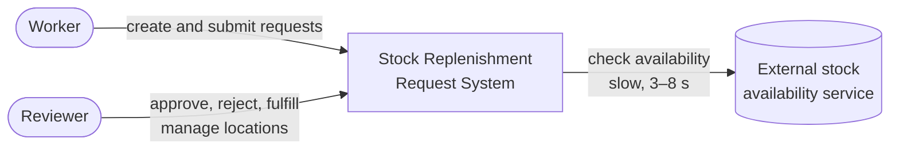
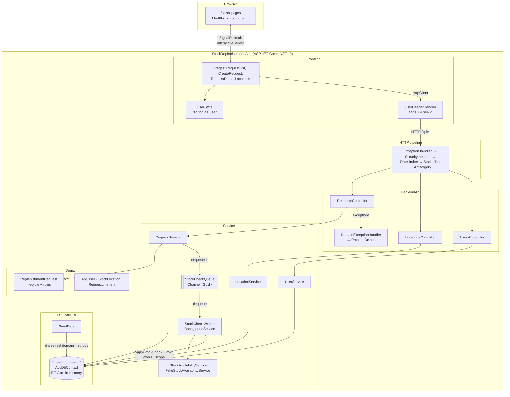
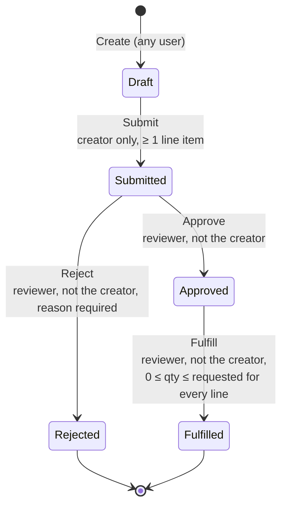
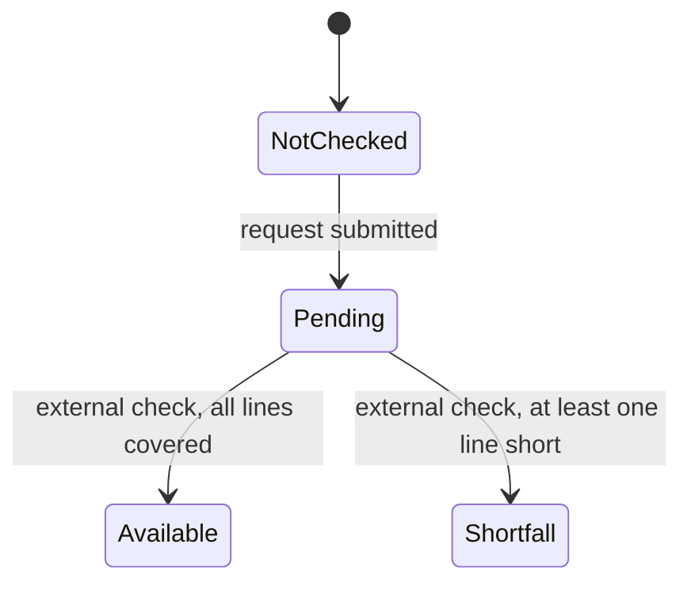
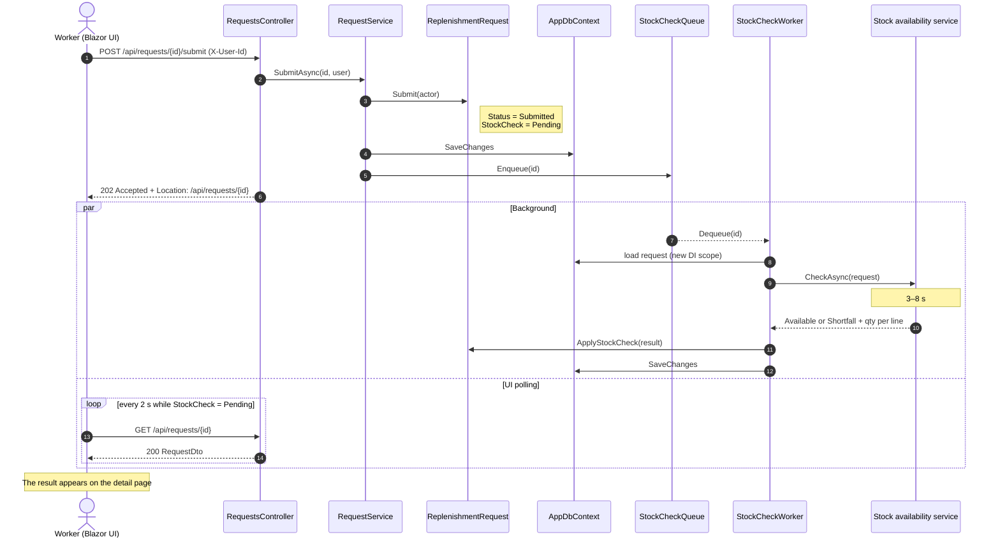
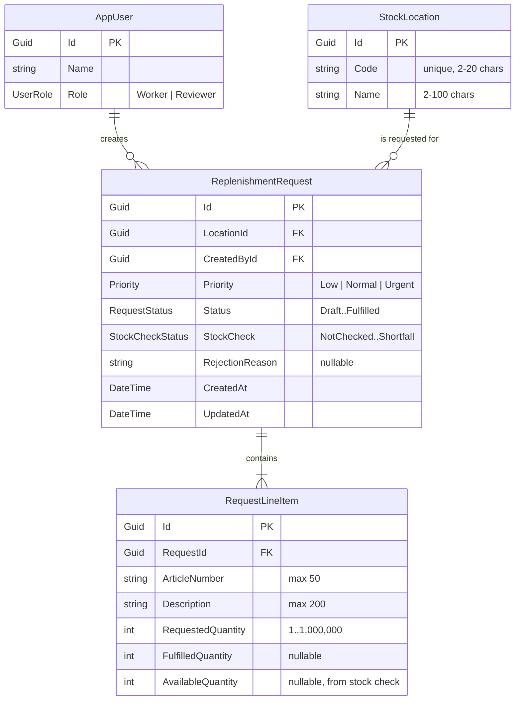
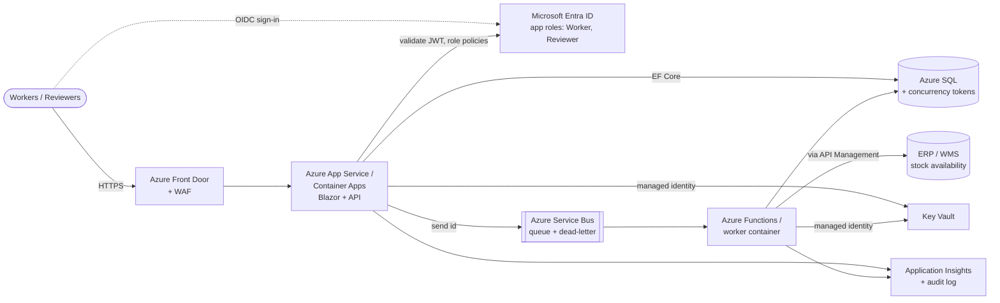

# Architecture

This document explains how the Stock Replenishment Request System is built and why. The diagrams use Mermaid, so GitHub renders them directly.

- [1. Context](#1-context)
- [2. Architecture style](#2-architecture-style)
- [3. Component view](#3-component-view)
- [4. Request lifecycle (state machine)](#4-request-lifecycle-state-machine)
- [5. Asynchronous stock check](#5-asynchronous-stock-check)
- [6. Data model](#6-data-model)
- [7. API reference](#7-api-reference)
- [8. Error handling](#8-error-handling)
- [9. Security design](#9-security-design)
- [10. Testing strategy](#10-testing-strategy)
- [11. Design decisions](#11-design-decisions)
- [12. Path to production (Azure)](#12-path-to-production-azure)

---

## 1. Context

Factory workers request material refills when stock runs low at their station. A reviewer approves or rejects each request, and approved requests get fulfilled. Before a reviewer decides, an external stock availability system is checked. That system is slow (3–8 seconds), so the check must not block the user.



| Actor | Can do |
|---|---|
| **Worker** | Create a request (location, priority, line items) and submit their own requests |
| **Reviewer** | Everything a worker can, plus approve, reject and fulfill (never their own requests) and manage stock locations |
| **External stock service** | Report the available quantity per line item (simulated by `FakeStockAvailabilityService`) |

## 2. Architecture style

A **modular monolith** with a **layered architecture** and a **rich domain model**:

- One deployable ASP.NET Core app hosts both the REST API and the Blazor UI. There's one process, one port and nothing to orchestrate locally.
- The layers are folders with a one-way dependency direction: `Frontend → BackendApi → Services → Domain`. `DataAccess` is used by `Services`.
- **Business rules live in the domain entity**, not in controllers or services. `ReplenishmentRequest` exposes behaviour (`Submit`, `Approve`, `Reject`, `Fulfill`, `ApplyStockCheck`) with private setters, so an invalid state transition can't be written from anywhere.
- **The slow external dependency sits behind a queue and a background worker** (asynchronous request-reply pattern), so the API stays fast.
- Each layer registers itself through one extension method in `DependencyInjection.cs` (`AddDataAccess`, `AddApplicationServices`, `AddBackendApi`, `AddFrontend`).

## 3. Component view



**Why the Blazor pages call the API over HTTP** instead of calling the services directly: the UI then uses exactly the same contract, validation, rate limiting and server-side rules as any other client (Postman, another system). The UI can't bypass a rule that the API enforces.

### Folder map

| Folder | Responsibility | Key types |
|---|---|---|
| `Domain/` | Entities, enums, lifecycle and authorization rules | `ReplenishmentRequest`, `ForbiddenException` |
| `Services/` | Application services: load → call domain method → save. The queue and the worker | `RequestService`, `LocationService`, `StockCheckQueue`, `StockCheckWorker` |
| `BackendApi/` | Controllers, DTOs with validation attributes, error mapping | `RequestsController`, `Dtos.cs`, `DomainExceptionHandler` |
| `DataAccess/` | EF Core context and relationships | `AppDbContext` |
| `Database/` | Startup seed data | `SeedData` |
| `Frontend/` | Blazor pages, layout, acting-user state, header handler | `RequestDetail.razor`, `UserState`, `UserHeaderHandler` |

## 4. Request lifecycle (state machine)

Every transition is a method on `ReplenishmentRequest`. A transition from the wrong status throws `InvalidOperationException` (409), and a wrong actor throws `ForbiddenException` (403).



The stock check has its own small state, which runs in parallel with the main status:



`ApplyStockCheck` only acts while the check is `Pending`, so a duplicate or late result is ignored (idempotent).

### Business rules

| Rule | Where it's enforced |
|---|---|
| Only the creator can submit | `ReplenishmentRequest.Submit` |
| A request needs at least one line item | DTO (`MinLength(1)`) and `Submit` |
| Approve, reject and fulfill need a reviewer who isn't the creator (segregation of duties) | `RequireReviewer` |
| A rejection needs a reason | DTO (`Required`) and `Reject` |
| The fulfilled quantity must be between 0 and the requested quantity, for every line, and only for lines of this request | `Fulfill` |
| Only reviewers manage locations; location codes are unique (case-insensitive) | `LocationService` |
| A location that requests still refer to can't be deleted | `LocationService.DeleteAsync` (409) |

## 5. Asynchronous stock check

The external stock check takes 3–8 seconds. The API uses the **asynchronous request-reply** pattern so the user never waits on it.



Design notes:
- **`Channel<Guid>`** is an in-process, thread-safe producer/consumer queue. Only the id is queued; the worker reloads fresh state from the database.
- The worker is a **singleton `BackgroundService`** and creates a **new DI scope per message**, because `AppDbContext` is scoped.
- **Failures are isolated.** One failing check is logged and the worker continues with the next message. Shutdown (`OperationCanceledException`) isn't swallowed.
- **Idempotent consumer.** If the request is missing or no longer `Pending`, the message is skipped.
- **Trade-off:** the queue lives in memory, so pending checks are lost if the process restarts. See [section 12](#12-path-to-production-azure) for the durable version.

## 6. Data model



The seed data creates 2 workers, 2 reviewers, 3 locations (`LINE-A`, `LINE-B`, `PAINT-1`) and one request in each state (Draft, Submitted + Available, Submitted + Shortfall, Approved, Rejected, Fulfilled). The seeder calls the real domain methods, so the seed data can't be in an illegal state.

## 7. API reference

Base URL: `http://localhost:5000`. Enums are serialized as strings (`"Urgent"`, `"Submitted"`). Write endpoints need the `X-User-Id` header (the acting user's id from `GET /api/users`).

| Method | Route | Who | Success | Notes |
|---|---|---|---|---|
| GET | `/api/users` | anyone | 200 | Seeded users and roles |
| GET | `/api/locations` | anyone | 200 | Ordered by code |
| POST | `/api/locations` | reviewer | 201 | `{ code, name }`, unique code |
| PUT | `/api/locations/{id}` | reviewer | 200 | |
| DELETE | `/api/locations/{id}` | reviewer | 204 | 409 if requests refer to it |
| GET | `/api/requests` | anyone | 200 | Filters: `status`, `priority`, `locationId`. Paging: `page` (≥ 1), `pageSize` (1–100, default 10). Returns `{ items, totalCount }`, newest first |
| GET | `/api/requests/{id}` | anyone | 200 | Polled by the UI during the stock check |
| POST | `/api/requests` | any user | 201 | `{ locationId, priority, lines: [{ articleNumber, description, requestedQuantity }] }`, 1–100 lines |
| POST | `/api/requests/{id}/submit` | creator | **202** | Starts the background stock check |
| POST | `/api/requests/{id}/approve` | reviewer ≠ creator | 200 | |
| POST | `/api/requests/{id}/reject` | reviewer ≠ creator | 200 | `{ reason }`, max 500 chars |
| POST | `/api/requests/{id}/fulfill` | reviewer ≠ creator | 200 | `{ lines: [{ lineItemId, fulfilledQuantity }] }` for every line |

Example:

```bash
curl -X POST http://localhost:5000/api/requests \
  -H "Content-Type: application/json" \
  -H "X-User-Id: <worker-id>" \
  -d '{"locationId":"<location-id>","priority":"Urgent","lines":[{"articleNumber":"ART-1001","description":"M6 Hex Bolt","requestedQuantity":500}]}'
```

The `postman/` collection does this end to end. It captures ids into variables automatically.

## 8. Error handling

Domain and service code throws plain .NET exceptions with business-level messages. `DomainExceptionHandler` (an `IExceptionHandler`) maps them to [RFC 9457](https://www.rfc-editor.org/rfc/rfc9457) problem details:

| Exception | HTTP | Example |
|---|---|---|
| `KeyNotFoundException` | 404 Not Found | Request or location doesn't exist |
| `ForbiddenException` | 403 Forbidden | A worker tries to approve; a reviewer approves their own request |
| `InvalidOperationException` | 409 Conflict | Approving a Draft; deleting a location in use; duplicate location code |
| `ArgumentException` | 400 Bad Request | Missing rejection reason; unknown user; fulfilled qty > requested |
| DTO validation (`[ApiController]`) | 400 Bad Request | Validation problem details listing each field |
| Anything else | 500 | Generic message with no stack trace |
| Rate limit exceeded | 429 Too Many Requests | |

## 9. Security design

| Control | Implementation | Threat addressed |
|---|---|---|
| Server-side authorization | Every role and lifecycle rule is checked in the domain/service layer. The UI only hides buttons | Bypassing the UI, forged API calls |
| Segregation of duties | A reviewer can't approve, reject or fulfill their own request | Insider fraud, self-approval |
| Input validation | Data annotations with ranges and length limits; max 100 line items; page size max 100 | Oversized payloads, resource exhaustion |
| Rate limiting | Fixed window per client IP: 100 requests / 10 s → 429 | Bursts, scripted abuse |
| Security headers | `X-Content-Type-Options: nosniff`, `X-Frame-Options: DENY`, `Referrer-Policy: no-referrer` | MIME sniffing, clickjacking, URL leakage |
| Injection-safe by design | EF Core parameterized queries; Blazor HTML-encodes output; antiforgery enabled | SQL injection, XSS, CSRF |
| No information leakage | Problem details with business messages; generic 500 | Stack-trace and internals disclosure |
| Pinned package source | `nuget.config` clears machine feeds and uses only nuget.org | Dependency confusion |

**Known limitation (on purpose, authentication was out of scope):** `X-User-Id` is client-supplied and can be spoofed. The production fix is in the next section.

## 10. Testing strategy

33 NUnit tests, `dotnet test`:

| Suite | Tests | Approach |
|---|---|---|
| `LifecycleTests` | 18 | Pure domain tests on `ReplenishmentRequest`: every valid transition, every invalid transition, role and self-approval rules, fulfillment bounds, stock-check idempotency. No mocks or database |
| `RequestServiceTests` | 8 | `RequestService` with the EF Core in-memory database and an NSubstitute mock of `IStockCheckQueue` (verifies that submit enqueues the id), paging and filters |
| `LocationServiceTests` | 7 | CRUD, reviewer-only rule, unique codes, delete blocked when in use |

The domain is tested without infrastructure, because it has none. That's the main payoff of the rich domain model. The Postman collection covers the HTTP contract end to end, including an "Error scenarios" folder (400, 403, 404).

## 11. Design decisions

| Decision | Chosen | Alternatives considered | Why |
|---|---|---|---|
| Where the rules live | Rich domain entity with private setters | Rules in services or controllers (anemic model) | One place for rules; impossible to bypass; testable without mocks |
| Slow external check | 202 Accepted + in-process queue + background worker + client polling | Synchronous call; fire-and-forget `Task.Run`; SignalR push | Non-blocking; the worker has a proper DI scope and lifetime; polling is simple and robust |
| Queue | `System.Threading.Channels` | Hangfire, Azure Service Bus | No extra infrastructure for the scope; swappable behind `IStockCheckQueue` |
| Persistence | EF Core in-memory provider | SQLite, SQL Server | Zero setup to run; same EF Core code works with a real provider |
| UI | Blazor interactive server + MudBlazor | React/Angular SPA | One language and one deployable; rich components out of the box |
| UI → backend | UI calls the REST API over `HttpClient` | Blazor injects services directly | The UI goes through the same validation, rate limiting and rules as any client |
| Identity | `X-User-Id` header + "Acting as" switcher | Real login | Authentication was out of scope; makes demoing roles instant |
| Error contract | Exceptions → problem details in one handler | `Result<T>` types, try/catch in every controller | Thin controllers; a consistent, standard error format |

## 12. Path to production (Azure)

How this design would grow into a production system. Every swap happens behind an interface that already exists, so the domain code doesn't change.



| Today | Production | Behind |
|---|---|---|
| `X-User-Id` header | Entra ID (OIDC) with app roles `Worker` / `Reviewer`; role checks as ASP.NET Core authorization policies; the user id comes from token claims | Controllers' `RequireUser` |
| EF Core in-memory | Azure SQL (or PostgreSQL) with migrations and a `rowversion` concurrency token, so two reviewers can't approve the same request at once | `AppDbContext` |
| `Channel<Guid>` | Azure Service Bus queue with retries and a dead-letter queue; the outbox pattern so "saved" and "enqueued" can't drift apart | `IStockCheckQueue` |
| `FakeStockAvailabilityService` | A typed `HttpClient` to the ERP/WMS through API Management, with Polly retry, timeout and circuit breaker | `IStockAvailabilityService` |
| Polling every 2 s | SignalR push when the check completes (keep polling as a fallback) | `RequestDetail.razor` |
| Console logging | Application Insights / OpenTelemetry traces across API → queue → worker; an audit trail of who approved, rejected or fulfilled what | `ILogger` |
| Basic headers | HTTPS + HSTS, Content-Security-Policy, WAF, locked-down CORS | `Program.cs` |
| Manual run | CI/CD (GitHub Actions): build, test, `dotnet list package --vulnerable`, Dependabot, infrastructure as code (Bicep) | — |
